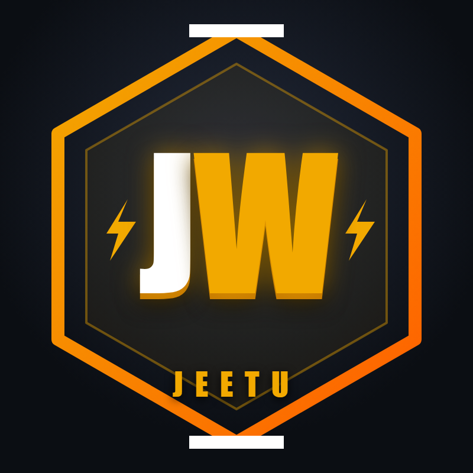
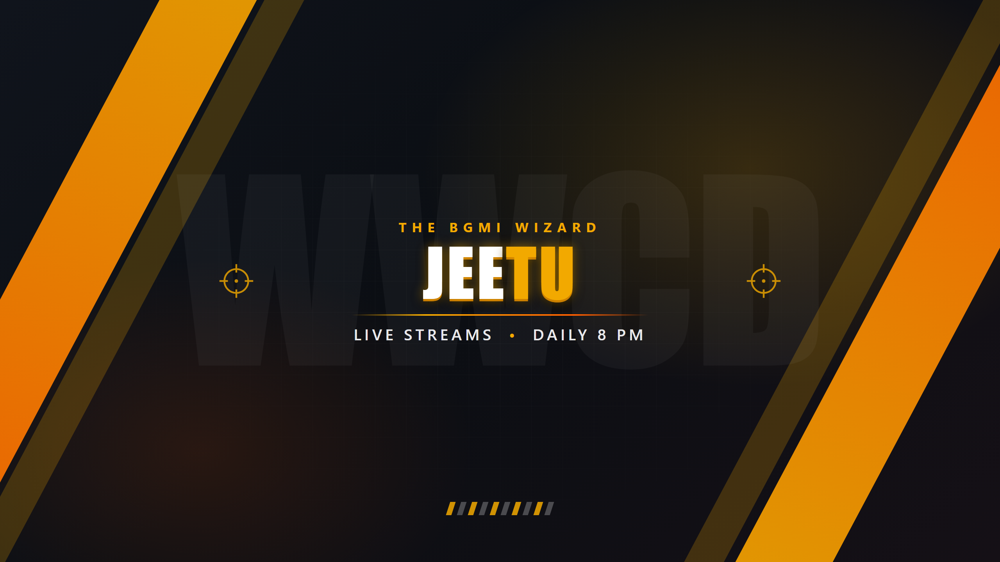

# Jeetu Wizard — Context

Everything about the **Jeetu — The BGMI Wizard 🧙‍♂️** channel in one place: brand, accounts, streaming setup, team workflow, ready-to-paste texts, checklists, and the design source files.

> **New Claude session?** Open this repo in Claude Code. It reads [CLAUDE.md](CLAUDE.md) automatically and has the full project context. On claude.ai, paste the contents of [CLAUDE.md](CLAUDE.md) as your first message.

## Quick links

| Platform | Link |
|---|---|
| YouTube | [youtube.com/@JeetuWizard](https://www.youtube.com/@JeetuWizard) |
| Instagram (team) | [instagram.com/jeetuwizard](https://www.instagram.com/jeetuwizard/) |
| Facebook Page | Jeetu Wizard (managed in [Meta Business Suite](https://business.facebook.com)) |
| Team playbook (Google Doc) | [Jeetu wizard doc](https://docs.google.com/document/d/1E4lZTPFgEhOh3RUF158vVcgi_eFkPW9EokBjWHMQJmw/edit) |
| Google Drive (videos, clips, reels) | [Jeetu Wizard Drive](https://drive.google.com/drive/u/1/folders/1BM1HMgl6o5xHGDHBY0xgfZjO-TuD4z9a) |

## What's in this repo

| Path | Contents |
|---|---|
| [CLAUDE.md](CLAUDE.md) | Full context briefing for Claude, loaded automatically in Claude Code |
| [docs/01-brand-and-accounts.md](docs/01-brand-and-accounts.md) | Name, colors, handles, account status |
| [docs/02-streaming-setup.md](docs/02-streaming-setup.md) | iPad → capture card → OBS → YouTube, settings |
| [docs/03-team-and-workflow.md](docs/03-team-and-workflow.md) | Roles, Meta Business Suite permissions, posting flow |
| [docs/04-texts.md](docs/04-texts.md) | YouTube description, Instagram and Facebook bios |
| [docs/05-video-editing.md](docs/05-video-editing.md) | ffmpeg reel pipeline plan |
| [docs/06-checklists.md](docs/06-checklists.md) | Pre-stream checklist, launch checklist (pending items) |
| [docs/07-growth-principles.md](docs/07-growth-principles.md) | What actually grows the channel |
| [docs/08-storage.md](docs/08-storage.md) | Repo vs Google Drive: what goes where, Drive folder layout |
| [.claude/skills/](.claude/skills/) | Claude Code skills: `design-asset`, `make-reel`, `stream-post`, `sync` |
| [assets/final/](assets/final/) | Banner, profile picture, watermark currently in use |
| [assets/alternates/](assets/alternates/) | Rejected profile picture options, kept for reference |
| [design-src/](design-src/) | HTML/CSS/SVG sources for every asset |
| [scripts/render-assets.ps1](scripts/render-assets.ps1) | Re-renders all PNGs from the design sources |
| [reels/](reels/) | Code-built motion reels (trailer/promo), one folder each with visuals, sound, and rebuild steps |
| [scripts/render-reel.mjs](scripts/render-reel.mjs) | Records a reel page to frames for ffmpeg |

## Brand at a glance

  
  &nbsp;
  

- **Name:** Jeetu — The BGMI Wizard
- **Colors:** dark navy/black + orange `#F2A900`
- **Schedule:** live daily at 8 PM
